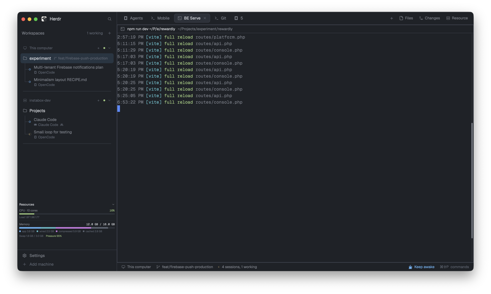

# Minimalism (Herdr layout)

A compact, borderless [Herdr](https://herdr.dev) layout: a chrome sidebar with workspace sessions tree view and footer with keep awake, a tight terminal tab strip, framed panes with a custom header, an optional right panel (Files/Changes/Resource), and a status bar.



## Install
Ask your agent to install it


```sh
Read ~/.config/herdr-app/AGENTS.md, 
then add this layout: https://github.com/rvibit/herdr-layout-minimalism/tree/main
```

> Before installing, review the files. Mods are trusted code and can run programs, access files, and reach the network.

### 3. Switch to the layout if required

```sh
herdr-app do layout.switch '{"name":"minimalism"}'
```

You can switch back anytime with `Ctrl+Shift+L` (`layout.switch`) or by selecting another layout. Deleting `layouts/minimalism.json` (and the mod/theme files you added) removes it.

## More details

- [`RECIPE.md`](RECIPE.md) — full brief (regions, behavior, node tree/mods/commands, caveats, and "done when" checks) written from the real files.
- [`layouts/minimalism.json`](layouts/minimalism.json) — the layout definition.
- [`themes/`](themes/) and [`mods/`](mods/) — themes and mod source/assets.

## Uninstall

Remove the files you copied:

```sh
dst="${HERDR_APP_HOME:-$HOME/.config/herdr-app}"
rm "$dst/layouts/minimalism.json"
rm -rf "$dst/mods/"minimalism-*
rm "$dst/themes/minimalism.json" "$dst/themes/minimalism-light.json" "$dst/themes/minimalism-indigo.json"
```

(Only remove theme/mod files if you aren't using them elsewhere.) If Minimalism was the active layout, switch to another layout first.
