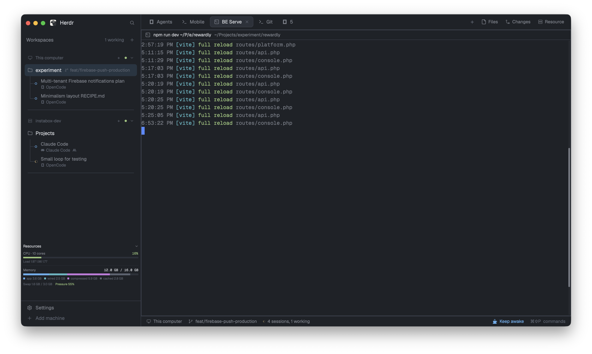

# Minimalism

A compact, borderless Herdr layout: a chrome sidebar with workspace sessions and a status footer on the left, a tight terminal tab strip and framed panes in the center, an optional right panel for Files/Changes/Resource, and a status bar at the bottom. It follows the system appearance with the `minimalism` dark theme and `paper` in light mode.

## What you see

- **Window (root row, `canvas` background, 1px `border` divider):** no system title bar (`"titlebar": "none"`), macOS traffic lights at `[12, 16]`, window preview `layouts/minimalism.png`. Root sets `theme` `{ "light": "paper", "dark": "minimalism" }`, `terminal_padding` `[0, 0]`, `terminal_opacity` `0`.
- **Sidebar (`column`, 320px, min 200, max 440, resizable, `chrome` background):**
  - `brand` block (46px, `window_drag: true`, mod `minimalism-workspace-chrome`): Herdr app icon and "Herdr" on the left, a search button on the right that opens the `picker` mod. On macOS (non-fullscreen) content is inset left by 76px to clear traffic lights.
  - `sidebar-lists` block (fills, mod `minimalism-workspaces`): header row "Workspaces" with working count and a + button (`space.new`); scrollable list of spaces and their agent/session rows.
  - `resource-mini` block (120px, min 100, max 160, mod `resource-mini`): compact resource display (shipped mod).
  - `sidebar-footer` block (69px, min 30, max 69, mod `workspace-chrome` with props `{ "footer": true }`): Settings row and "Add machine" row (shipped mod; shows update dot when `updates().app.ready`).
- **Work (`column`, fills, not resizable):**
  - `tabs` block (42px, `window_drag: true`, mod `minimalism-terminal-tabs`, `chrome` with bottom `border`): sidebar toggle when sidebar hidden, scrollable tab pills, + menu (`new-menu` popup 250×512), Files/Changes/Resource panel toggles, and window buttons on platforms that draw them.
  - `work-body` row (fills, padding 0, gap 8): 
    - `main` block showing `tab: "active"` with pane frame: `minimalism-pane-header` (26px, top, always revealed), pane `background` `chrome`, `border` 1px `border`, focus `1px` `input`, `radius` 0, `gap` 4, `lone: true`.
    - `panel` column (368px, min 280, max 900, **hidden** by default): a `stack` `panel-body` with children `files` (mod `files`), `changes` (mod `changes`), `processes` (mod `resource-monitor`), active `files`.
  - `status` block (28px, mod `minimalism-session-status`, `chrome` with top `border`): machine, branch, session/working summary, Keep awake toggle, and command-palette hint.
  - `ntfy-alerts` block (0px, mod `ntfy-alerts`).

## How it behaves

- **Themes/colors:** dark appearance uses `themes/minimalism.json` (Atom One Dark-derived): terminal bg `#21252b`, fg `#abb2bf`, selection `#323844`, cursor `#528bff`, 16 ANSI colors, and UI colors including canvas `#1b1f24`, chrome `#1e2227`, surface `#21252b`, popover `#282c34`, raised `#2c313a`, border `#3a3f4b`, input `#3e4451`, accent/idle/solid `#61afef`, working `#e5c07b`, blocked `#e06c75`, done `#98c379`. Light uses shipped `paper`. Also included: `themes/minimalism-light.json` (light variant, canvas `#f0f1f3`, chrome `#f5f6f8`, accent `#5c67f7`) and `themes/minimalism-indigo.json` (dark, canvas/background `#0c0d0f`, accent `#5c67f7`).
- **Spaces sidebar (`minimalism-workspaces`):** extends the spaces-base behavior (git/worktree grouping, machine awareness, folder watching, reorder). Shows each space header (folder/workspace icon or branch icon for worktrees) with name, optional branch, and git branch tooltip; click selects the space (`space.select`), right-click opens `minimalism-menu` as a space popup. Lists session/agent rows per space: harness icon (or `cursor` for `cursor-agent`), title (cleaned of `OC |` prefix), harness name, optional provider-family mark (`anthropic.svg` or `openai.svg` for matching models), model, and status. Status indicators: `working` = spinning `mods/workspace-chrome/spinner.svg` (7px in list, `t.working`, `.spin(900)`), `blocked` = 6px dot `t.ansi1`/blocked color, `done` = 6px dot `t.ansi4`/done color, `idle` = 6px dot `t.chrome` with colored border. Clicking a session runs `pane.focus` for its terminal and, for OpenCode-bridge sessions, focuses that session. When a space has multiple agent rows they are drawn with a left branch rail/elbow connector. The focused session shows a 2px accent bar at the right edge. Publishes `shared("minimalism.sessions")` as `{sessions, working}` counts and sets agent navigation order via `setAgentOrder(...)`. Reads optional OpenCode metadata via `data/herdr-app-bridge/<pid>.json` (watched; 30s fallback if watching unavailable).
- **Tabs (`minimalism-terminal-tabs`):** shows active space's tabs as pills (29px high, rounded 7, border/chrome/raised by active state). Each tab shows program icon (tinted svg or image) when available, name (or program name for default `tb…` tabs, with ` Z` when zoomed), working spinner and/or blocked/done dot, and a close button when active. Left press selects/moves: dragging to another tab runs `tab.move`; click selects `tab.select`. Right-click opens `minimalism-menu` for the tab. Close button runs `tab.close`. Mouse wheel over the bar runs `tab.prev`/`tab.next`. Sidebar-show button appears when sidebar hidden (`layout.show sidebar`). `+` opens `new-menu` popup. Panel buttons toggle `panel`/`panel-body` for enabled panels from `shared("workspace.panels")` (defaults to `files, changes`, ensures `processes` available). Panel choice is remembered per space in localStorage `panels` and restored on space switch; narrow saved sidebars (<160px) are reset hidden to 330px on init. Shows window minimize/maximize/close buttons where `window().buttons` is true (Windows uses vector svg icons; restore icon when maximized).
- **Pane header (`minimalism-pane-header`):** 26px bar per pane, click focuses pane. Shows working spinner, or a "Needs you" badge for `blocked` (accent-tinted), or a done dot. Shows program/shell icon, pane name (agent/shell name, terminal title, or cwd leaf for shell foreground), and context (foreground name for shell, path otherwise). On hover reveals split-right, split-down, zoom/unzoom, close buttons (`mods/minimalism-pane-header/*.svg`).
- **Status bar (`minimalism-session-status`):** shows "This computer" or machine name, current space branch if any, and session counts from `shared("minimalism.sessions")` with working spinner or idle dot. "Keep awake" toggles `shared("keepAwake")`: on macOS runs `caffeinate -d -i -u`, on Linux `systemd-inhibit ... sleep infinity`, on Windows a PowerShell suspend-state call; on close attempts to kill the spawned pid. Palette hint shows the actual bound global `app.palette` key (or "commands").
- **Menu (`minimalism-menu`, popup 200×260 default, keyboard-focusable):** context menu for space or tab targets only. Tab menu: New tab (`tab.new` in that space), Close (`tab.close`). Space menu: if a git checkout, New/Open worktree (opens `worktree` dialog 440×260 / 560×480); if a linked worktree, Remove worktree; then Close space (`space.close`). Up/Down/Enter/Escape navigate and activate; items show icons from `mods/minimalism-workspace-chrome/`.

## Built from

- **Layout:** `layouts/minimalism.json` (cloned_from `main` v0.1.13). Node tree: root row → `sidebar` column (`brand`, `sidebar-lists`, `resource-mini`, `sidebar-footer`) + `work` column (`tabs`, `work-body` row with `main` tab block and hidden `panel` stack, `status`, `ntfy-alerts`). Main pane config uses header mod `minimalism-pane-header`, background `chrome`, border/focus, gap 4, radius 0, lone true.
- **Mods included:** `mods/minimalism-workspaces/` (main.js, spaces-base.js, opencode-bridge.js, screenshot.js, model.js, anthropic.svg, openai.svg), `mods/minimalism-workspace-chrome/` (main.js, UI svg icons, spinner.svg), `mods/minimalism-terminal-tabs/` (main.js, win-*.svg), `mods/minimalism-pane-header/` (main.js, split-right.svg, split-down.svg, zoom.svg, unzoom.svg, close.svg), `mods/minimalism-menu/` (main.js, model.js), `mods/minimalism-session-status/` (main.js, coffee.svg). All `mod.json` use `"place": "none"` (minimalism-menu also sets overlay width/height 200×260).
- **Themes:** `themes/minimalism.json` (dark), `themes/minimalism-light.json`, `themes/minimalism-indigo.json`.
- **Shipped/assumed mods and assets used by this layout:** `resource-mini`, `workspace-chrome` (footer props), `files`, `changes`, `resource-monitor`, `ntfy-alerts`, `new-menu`, `picker`, `worktree`, `machine-add`; icons referenced from shipped mods `mods/files/file.svg`, `mods/changes/changes.svg`, `mods/pane/close.svg`, `icons/shell.svg`, harness icons in `icons/*.svg` (opencode/claude/codex/pi/cursor etc.), and `frame/welcome/herdr.png`.
- **Key `herdr` APIs/commands:** `spaces`, `panes`, `terminals`, `agents`, `machines`, `focused`, `layout`, `theme`, `window`, `settings`, `shared/setShared`, `keys`, `updates`, `run`, `openOverlay`, `closeOverlay`, `exec`, `hc`, `readTextFile`, `writeTextFile`, `watchFolder`, `appHome`, `home`, `setAgentOrder`, `nextCommand`, `props`. Commands used include `space.new/select/close`, `tab.new/select/move/close`, `pane.focus/split/zoom/close`, `layout.show/hide/select/resize`, `app.settings/palette`, `mod.open`, `window.minimize/maximize/close`.

## Watch out

- `layouts/minimalism.json` references shipped mods not included in this folder (`resource-mini`, footer `workspace-chrome`, `files`, `changes`, `resource-monitor`, `ntfy-alerts`) and opens shipped overlays/mods (`new-menu`, `picker`, `worktree`, `machine-add`). A fresh build must have these available in the target Herdr install.
- `minimalism-terminal-tabs` reads panel button icons from `mods/files/file.svg` and `mods/changes/changes.svg` and close/sidebar/spinner assets from shipped `mods/pane` and `mods/workspace-chrome` paths in some places while also bundling its own copies in `minimalism-workspace-chrome`; keep paths consistent with the real files.
- `minimalism-workspaces` imports `./spaces-base.js` (cloned/adapted from shipped spaces) and contains substantial git/machine/watch logic; behavior depends on `hc`/`git` availability and remote machine reachability. OpenCode bridge metadata is optional (`data/herdr-app-bridge/<pid>.json`); without it rows fall back to native terminal/agent info.
- `minimalism-session-status` "Keep awake" runs platform commands (`caffeinate`, `systemd-inhibit`, PowerShell) and stores pid in memory; cleanup on quit is best-effort (250ms). Windows keep-awake path is a minimal suspend-state call and may not behave like a held inhibitor.
- `minimalism-pane-header` action icons are expected at `mods/minimalism-pane-header/{split-right,split-down,zoom,unzoom,close}.svg`; the installed copy on this machine lacked them even though `main.js` referenced that path, so this package includes copies of the standard pane header icons.
- The layout sets `terminal_opacity` to `0` and zero terminal padding; this is intentional for the flat chrome look but differs from defaults.
- Screenshot/preview naming helpers exist in workspaces for `screenshot-*` commands; normal use is unaffected.

## Done when

- `herdr-app check ~/.config/herdr-app/mods/minimalism-workspaces` passes.
- `herdr-app check ~/.config/herdr-app/mods/minimalism-workspace-chrome` passes.
- `herdr-app check ~/.config/herdr-app/mods/minimalism-terminal-tabs` passes.
- `herdr-app check ~/.config/herdr-app/mods/minimalism-pane-header` passes.
- `herdr-app check ~/.config/herdr-app/mods/minimalism-menu` passes.
- `herdr-app check ~/.config/herdr-app/mods/minimalism-session-status` passes.
- Switching to the `minimalism` layout shows the chrome sidebar (brand/search, workspaces list with +, resource-mini, footer), the 42px tab strip with tabs and panel buttons, framed terminal panes with 26px headers, a hidden right panel stack, and the 28px status bar.
- Clicking a session row focuses its pane; tab close/+ and panel toggles work; right-clicking a space/tab opens the Minimalism menu with the expected actions.
- Dark mode uses `themes/minimalism.json` colors and light mode uses `paper` (or `minimalism-light` if selected) without invalid layout/theme errors.
